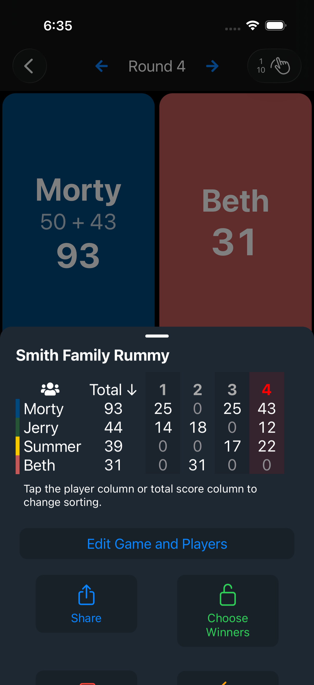
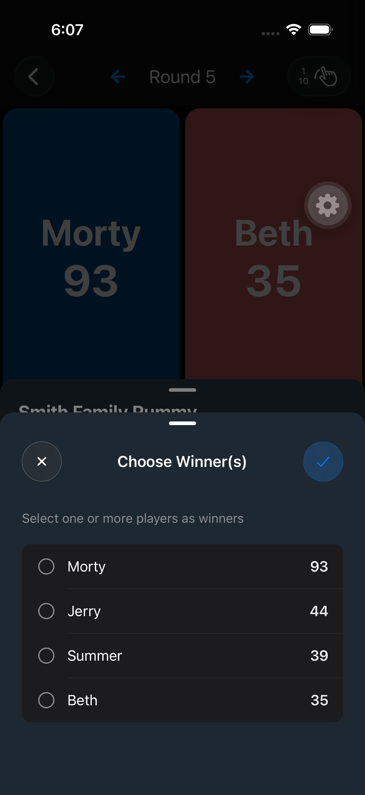

 ScorePad with Rounds
---

An open-source, cross-platform score keeping app with per-round score history. Tap to add points, hold for bigger values, and scroll back through every round.

<p>
  
  
</p>

## Download

- [Apple App Store](https://apps.apple.com/us/app/scorepad-with-rounds/id1577906063) (iPhone, iPad, Apple silicon Mac)
- [Google Play](https://play.google.com/store/apps/details?id=com.wyne.scorepad) (Android phones and tablets)
- Website: [scorepadapp.com](https://www.scorepadapp.com)

## Demo

https://github.com/wyne/scorepad-react-native/assets/1986068/05bde405-3025-4156-8c52-477d4b1f5912

## Tech stack

| Area | What's used |
|------|-------------|
| Framework | [Expo SDK 57](https://docs.expo.dev/) with React Native 0.86, React 19.2, TypeScript 6 |
| Navigation | React Navigation 7 (native stack) |
| State | Redux Toolkit 2 with `redux-persist` on AsyncStorage |
| UI | Reanimated 4, Gesture Handler, `@gorhom/bottom-sheet`, `@expo/ui`, SF Symbols via `expo-symbols` |
| Telemetry | Firebase Analytics and Crashlytics (`@react-native-firebase` 24) |
| Builds & updates | EAS Build, EAS Submit, and EAS Update (`expo-updates`) |
| Tests | Jest (`jest-expo`) with React Native Testing Library |
| E2E & screenshots | WebdriverIO 9 with Appium |
| Releases | [release-please](https://github.com/googleapis/release-please) driven by conventional commits |

## Project layout

```
App.tsx              App entry: store, persistence, navigation
src/screens/         Top-level screens (List, Game, EditGame, EditPlayer, Share, AppSettings, DebugLog)
src/components/      UI components grouped by feature (PlayerTiles, Sheets, Headers, Interactions, ...)
redux/               Games, Players and Settings slices, selectors, store, backup
plugins/             Local Expo config plugins
patches/             patch-package patches, applied on npm install
e2e/                 WebdriverIO + Appium flows for screenshots and recordings
scripts/             Release preflight and IPA helpers
docs/                Build guides, glossary, marketing assets
```

## Getting started

Prerequisites: Node.js from [`.nvmrc`](.nvmrc) (currently 20.19.4), npm, and the [EAS CLI](https://docs.expo.dev/eas/). Building iOS needs Xcode and CocoaPods on macOS; building Android needs Android Studio and JDK 17. The full setup is in [Contributing.md](Contributing.md).

```zsh
nvm install && nvm use
npm install           # .npmrc sets legacy-peer-deps; postinstall applies patches/
npm run ios:dev       # or: npm run android:dev
```

The app uses native modules (Firebase, Reanimated and others), so it runs in a development build, not Expo Go. `ios:dev` and `android:dev` regenerate native code with `expo prebuild --clean`, then build and install the dev client. After that, `npm run dev` starts Metro for it.

### App variants

`APP_VARIANT` picks the bundle ID, display name, icon and Firebase config in [`app.config.js`](app.config.js), so all three can be installed side by side.

| Variant | Bundle ID | Name |
|---------|-----------|------|
| `development` | `com.wyne.scorepad.dev` | ScorePad (dev) |
| `preview` | `com.wyne.scorepad.preview` | ScorePad (preview) |
| production (unset) | `com.wyne.scorepad` | ScorePad with Rounds |

Set `EXPO_PUBLIC_FIREBASE_ANALYTICS=false` to turn analytics off. The development and preview EAS profiles already do.

## Scripts

| Command | What it does |
|---------|--------------|
| `npm run dev` | Start Metro with `APP_VARIANT=development` |
| `npm start` | Start Metro for the dev client |
| `npm run ios:dev` / `android:dev` | Clean prebuild, then build and run the development variant |
| `npm run ios:preview` / `android:preview` | Clean prebuild, then build and run a release build of the preview variant |
| `npm run ios` / `android` | Clean prebuild, then build and run a release build of production |
| `npm run prebuild` / `prebuild:clean` | Regenerate the native `ios/` and `android/` projects only |
| `npm run web` | Start the web build |
| `npm run lint` | ESLint, then `tsc` |
| `npm test` | Run the Jest suite |
| `npm run test:watch` | Jest in watch mode |
| `npm run test:coverage` | Jest with coverage and the enforced thresholds |
| `npm run e2e:install` | Install the latest simulator build on the e2e simulators |
| `npm run e2e` / `e2e:record` | Run the Appium screenshot flow, or record it |
| `npm run install:ipa` | Pick a built `.ipa` from the repo root and install it on a device |

Device and store builds go through EAS, for example `npx eas build --profile preview --platform ios`. See [docs/build-ios.md](docs/build-ios.md) and [docs/build-android.md](docs/build-android.md).

## Testing

Tests sit next to the code they cover as `*.test.ts(x)`. Coverage thresholds live in [`jest.config.ts`](jest.config.ts) (statements 24%, branches 18%, functions 20%, lines 25%), and `npm run test:coverage` fails below them.

## CI

All workflows are in [`.github/workflows`](.github/workflows).

| Workflow | Runs on | What it does |
|----------|---------|--------------|
| `node.yml` | Pushes and PRs to `main` | Lint, type check, tests with coverage, coverage comment on the PR |
| `pr-checks.yml` | Every PR and non-`main` branch | Conventional PR title check, lint, type check, tests |
| `release-preflight.yml` | PRs to `main` | `scripts/release-preflight.sh pr` |
| `release-please.yml` | Pushes to `main` | Maintains the release PR, and tags and publishes a release when it merges |
| `release-build.yml` | Called by `release-please.yml`, or manual | EAS production build for iOS and Android, then auto-submit |
| `beta.yml` | Pushes to `beta` | `eas update` to the `preview` channel |
| `codeql-analysis.yml` | `main` and weekly | CodeQL security scan |
| `claude.yml` | `@claude` in issues and PR comments | Claude Code on PRs and issues |

## Releases

Releases are automated. Merging the standing `chore: release X.Y.Z` PR tags the version, publishes the GitHub release, and queues EAS production builds that submit to App Store Connect and the Play internal track. Store review and promotion are still manual.

PR titles must follow [Conventional Commits](https://www.conventionalcommits.org/) (`fix:` bumps the patch version, `feat:` the minor, `feat!:` the major), because they decide the next version. Don't edit `version` in `package.json` by hand. The full process is in [AGENTS.md](AGENTS.md#releases), and past releases are in the [CHANGELOG](CHANGELOG.md).

## More docs

- [Contributing.md](Contributing.md): full environment setup, testing and code quality
- [docs/glossary.md](docs/glossary.md): product and code concepts
- [docs/build-ios.md](docs/build-ios.md) and [docs/build-android.md](docs/build-android.md): platform build guides
- [AGENTS.md](AGENTS.md): architecture notes and release details

## License

GPL-3.0. See [LICENSE](LICENSE).
