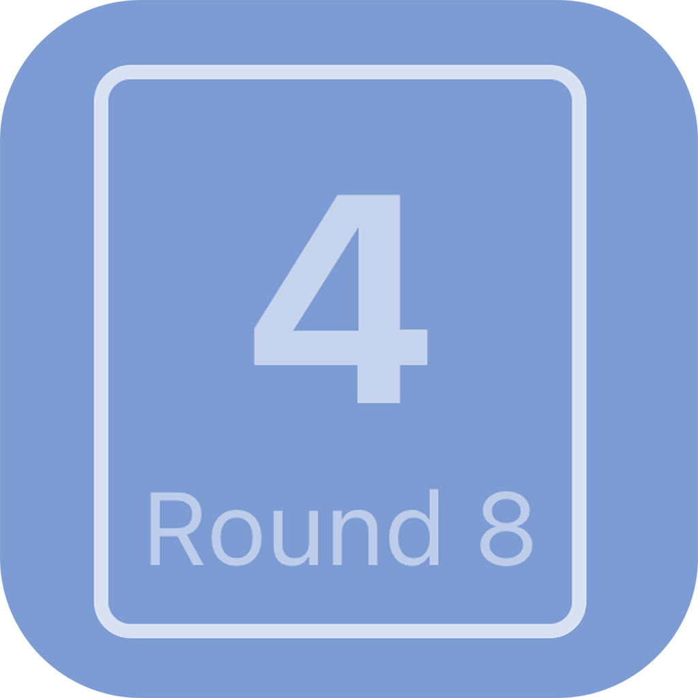

 ScorePad with Rounds
---

An open-source, multi-platform score keeping app with per-round score history.

## Download

- [Apple App Store (iPhone, iPad, and Mac)](https://apps.apple.com/us/app/scorepad-with-rounds/id1577906063)
- [Google Play Store (Android phones and tablets)](https://play.google.com/store/apps/details?id=com.wyne.scorepad)

## Website

https://www.scorepadapp.com

## Contributing

See [Contributing.md](Contributing.md).

## Project Glossary

See [docs/glossary.md](docs/glossary.md) for the main product and code concepts used throughout the project.
